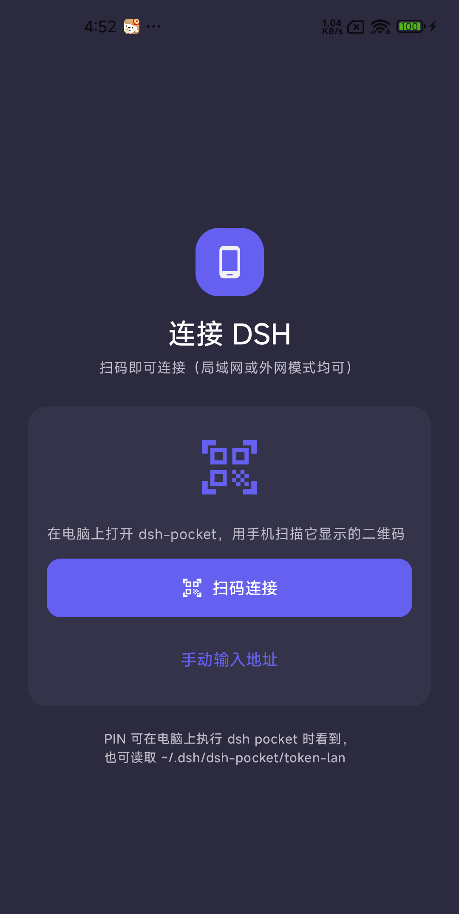
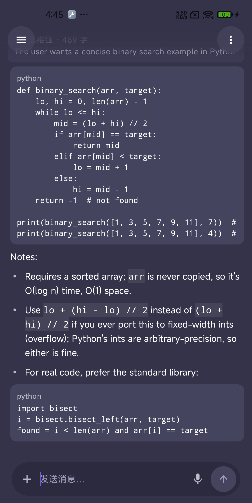

# dsh_mobile

**中文** | [English](README.en.md)

**DSH 的原生 Android 客户端** —— 直连 dsh-pocket 协议，不用 WebView。

在手机上把 DSH 当成一个正常的聊天 App 用：扫码配对、流式输出、工具调用可视化、语音输入、附件、会话管理。

<p align="center">
  
  &nbsp;&nbsp;
  
</p>

> ⚠️ **第三方客户端**：本项目不是 DSH 官方项目，协议行为通过抓包与源码反查得出，记录在 [docs/protocol.md](docs/protocol.md)。上游协议变化可能导致部分功能失效。

---

## 依赖

本客户端**必须配合 [`dsh-pocket`](https://github.com/shaobeichen/dsh-pocket) 使用** —— 它是运行在电脑侧的中转服务，提供手机配对用的二维码与 PIN。

支持两种连接模式，**扫码流程完全一样**：

| 模式 | 场景 | 说明 |
|---|---|---|
| **局域网** | 手机与电脑同一 Wi-Fi | 明文 HTTP，延迟最低 |
| **外网模式** | 手机在外网（蜂窝 / 其他网络） | 由 dsh-pocket 提供隧道，走 HTTPS/WSS |

完整链路：**手机 App ←(局域网 / 外网隧道)→ dsh-pocket ←→ DSH**。没有 dsh-pocket，本 App 无法连接。

## 功能

| 分类 | 能力 |
|---|---|
| **连接** | 扫码配对 / 手动输入地址+PIN；多服务器保存与切换；断线指数退避重连 + 快照重同步；DSH 重启后自动重登 |
| **会话** | 侧边栏按工作区分组（可折叠）、置顶、归档、搜索、重命名、派生新会话、**在工作区里新建会话** |
| **对话** | token 级流式输出、思维链折叠、工具调用卡片（含参数与结果）、Markdown 渲染、历史分页加载、中断当前回合 |
| **排队 / 插队** | 任务运行中发送自动排队（悬浮胶囊显示），支持**编辑 / 立刻发送 / 取消** |
| **附件** | 图片（内联发送 + 气泡内缩略图渲染）、文档（PDF / Office / 文本 / 代码，走 `uploadFileBinary` 上传），选中后**挂载待发**而不是立即发出；文档可用系统 App 打开 |
| **语音** | 系统语音识别转文字；语音态下输入栏整体切换为「波形 / 停止 / 发送」 |
| **界面** | 沉浸式无标题头部（浮动半透明控件）、单行输入胶囊、深浅双主题 + 4 种强调色 |

## 环境要求

- **手机**：Android 8.0+（minSdk 26）
- **电脑**：运行 DSH + 启动 [`dsh-pocket`](https://github.com/shaobeichen/dsh-pocket)
- **网络**：手机能访问到 dsh-pocket —— 同一局域网，**或** dsh-pocket 开启外网模式

## 快速开始

**1. 电脑侧**：启动 [`dsh-pocket`](https://github.com/shaobeichen/dsh-pocket)，它会显示二维码和 PIN。

**2. 构建安装**

```bash
# 需要 JDK 17 + Android SDK（compileSdk 36）
echo "sdk.dir=/path/to/Android/Sdk" > local.properties
./gradlew assembleDebug
adb install -r app/build/outputs/apk/debug/app-debug.apk
```

也可以直接下载 [Releases](https://github.com/selvinzr/dsh_mobile/releases) 里已签名的 APK。

> 使用 **AGP 9 + Gradle 9**，不要添加 `org.jetbrains.kotlin.android` 插件（Kotlin 支持已内置）。

**3. 配对**：打开 App → **扫码连接**（推荐）或手动输入地址与 PIN。二维码只含地址不含 PIN，PIN 是凭据需输入一次，之后 App 会记住。

## 架构

```
app/src/main/java/com/dsh/mobile/
├── core/                 语音输入、麦克风电平、配对码解析、错误类型
├── data/
│   ├── net/              WS 多路复用、RPC 客户端、Cookie 存储、PIN 握手
│   ├── repo/             所有 DSH RPC 的唯一出口
│   └── model/            会话/消息/工作区/排队/附件模型与事件归并（reducer）
└── ui/
    ├── theme/            配色与排版
    ├── components/       Markdown、消息卡片、工具卡片
    └── screens/          聊天、会话抽屉、设置、连接引导
```

- **单条 WebSocket 多路复用**：所有订阅共用 `/api/remote.mux`，按 `streamId` 分发，带 replay 缓冲避免首帧丢失
- **历史与实时同构**：`session/follow` 的快照记录与增量事件走**同一个 reducer**
- **队列的真相只有一个来源**：服务端 inbox（通过重订阅拿快照），不做本地臆测
- **状态收敛在 `AppViewModel`**，UI 层无业务逻辑

## 发布构建

```bash
# 从 keystore.properties 读取签名配置（该文件不入库）
./gradlew assembleRelease
# 产物：app/build/outputs/apk/release/app-release.apk（已签名）
```

若未配置 `keystore.properties`，CI 上可用环境变量 `DSH_STORE_FILE` / `DSH_STORE_PASSWORD` / `DSH_KEY_ALIAS` / `DSH_KEY_PASSWORD`。

## 已知限制

这些是**上游能力或协议限制**，不是 bug：

| 限制 | 说明 |
|---|---|
| ask-user 提问无法回答 | RPC 层面没有回答入口（源码级确认），只能看到提问卡片 |
| 历史文档附件无法重新下载 | 服务端不提供附件回取接口，只有本机刚发送的文档能打开 |
| `session/search` 在本部署被禁用 | 已改为本地过滤 |
| 目录浏览器 | 该部署只提供 native 能力，用已知工作区路径构建离线目录树 |

## 参与贡献

欢迎 PR。改动前建议先读 [docs/protocol.md](docs/protocol.md) —— 里面记录了协议的真实行为（含若干反直觉的坑，例如同一 `streamId` 重复 `open` 会被服务端以 1008 关闭整条连接）。

## 许可证

[MIT](LICENSE)

## 致谢

- [`dsh-pocket`](https://github.com/shaobeichen/dsh-pocket) —— 本客户端依赖的中转服务
- DSH（DeepSeek Harness）
